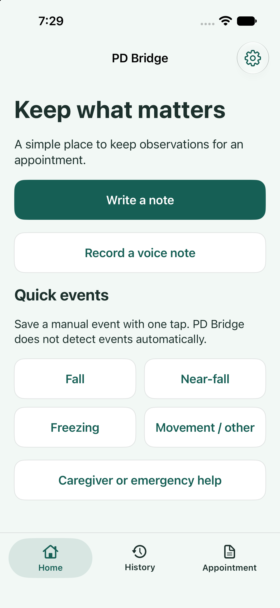

# PD Bridge for iPhone

PD Bridge is a **pre-release** SwiftUI observation journal and appointment-preparation app. It lets a person save notes in their own wording, record manual events, correct or delete entries, and select observations for a factual appointment report. Optional voice notes are reviewed before saving. This repository is source code, not an App Store download or a clinical product.



## Privacy and accessibility

The native app stores observations and saved audio in an AES-GCM encrypted, app-private local vault. Its device-only Keychain key is available when the phone is unlocked. Vault files are excluded from device backups. Users can create a passphrase-encrypted export through Files; any external copy remains under their control. The app includes Comfort Mode, Dynamic Type support, accessible control labels, and draft Gujarati, Hindi and Urdu interface resources. Those translations have **not** been human-validated.

The app does not provide diagnosis, treatment advice, automatic fall detection, emergency monitoring, live AI, cloud diary sync, or Apple Watch monitoring. The Watch code is experimental and is **not embedded in the iPhone Release app**.

## Build

Open `native/PDBridgeNative.xcodeproj` in a compatible stable Xcode. Select the **PDBridge** scheme. Use fictional data only. For an unsigned generic iOS build:

```sh
cd native
xcodebuild -project PDBridgeNative.xcodeproj -scheme PDBridge -configuration Release -destination 'generic/platform=iOS' CODE_SIGNING_ALLOWED=NO build
```

The project deliberately has no developer team configured in this public source. Device signing requires your own Apple team. Do not add certificates or provisioning profiles to Git.

The native contract checks are in `native/ios/Tests`; the iPhone-only packaging check is `python3 native/project/verify_iphone_only_release.py` run from `native/`. Simulator UI tests require a compatible simulator runtime and are not part of the unsigned CI build.

## Limitations and project history

HealthKit and real-time fall detection remain disabled. Personal Team signing is unsuitable for public distribution. A signed Release archive, App Store Connect disclosures and review, physical-device checks, and appropriate privacy/medical-regulatory review remain necessary before allowing real health observations.

See the [engineering case study](https://tanupunjani.github.io/pd-bridge-case-study/), [Privacy Policy](https://tanupunjani.github.io/pd-bridge-case-study/privacy.html), and [support page](https://tanupunjani.github.io/pd-bridge-case-study/support.html).

This public repository starts from a reviewed source snapshot. Earlier internal study and deployment history remains in a separate private local repository and is intentionally not published.

No open-source license has been granted. Public visibility alone does not grant permission to reuse this code or assets.
